## How to read this

Each word has up to three parts: what it means, in plain words; an everyday example; and how Koher, Split-Domain Cognition (SDC for short) or ungli use the word, since they sometimes give a word a meaning of its own.

The words sit in six groups. The first four cover what an AI model is, how one is trained, how a language model reads and how to find things by meaning. The fifth is about the ways models go wrong, and how anyone can tell. The last holds the words these projects use in a special sense.

When a fact comes from a research paper, the sentence names the paper and the list at the end gives it in full.

## 1. What a model is

**Artificial intelligence (AI).** Computer programs that do things once thought possible only for people, such as reading, recognising a face or answering a question. *Example:* the keyboard on a phone that guesses your next word. *In these projects:* the question Koher and SDC ask is less what AI can do than which jobs it should be given, and which it should never be given.

**Algorithm.** A set of steps a computer follows to get from a starting point to an answer, like a recipe. Every program is built from algorithms. Machine learning finds some of them from examples.

**Data.** The facts, words, pictures or sounds a computer works with. *Example:* the attendance marked in a class register is data.

**Input and output.** Input is what goes into a program or model. Output is what comes out. *In these projects:* much depends on what a model's output is allowed to be. In ungli a model may answer only with a number from a list it was given, or with nothing.

**Machine learning.** A way of making a program by showing it many examples instead of writing every rule by hand. The program finds the patterns itself. *Example:* nobody writes a rule for every handwritten 7. A program sees thousands of them and learns what a 7 tends to look like.

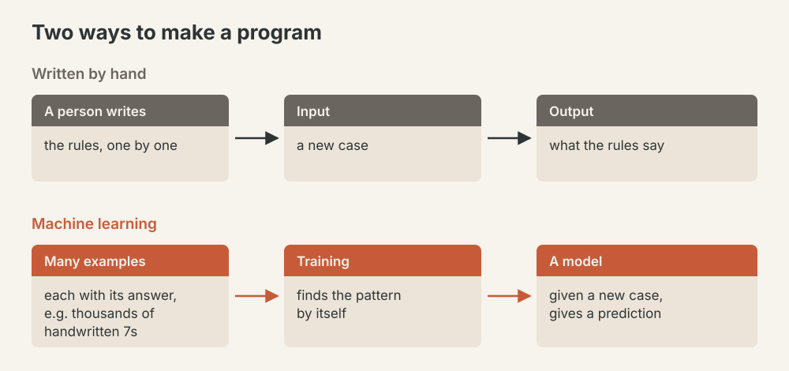{width=100%}

**Model.** The thing machine learning produces: a program that has learnt a pattern and can now use it on something new. *Example:* a model that has seen many photos of mangoes can say whether a new photo shows a mango. *In these projects:* a model never makes the final call. It may take a small, checkable step, such as pointing at a passage or picking from a list written in advance; the final call comes from rules that people wrote, or from a person.

**Prediction.** What a model gives back when it is used: its best guess at the answer. It may sound certain. Its output is still a prediction, not a known fact.

**Score and probability.** Many models attach a number to each answer, often between 0 and 1, for how strongly the answer fits. A probability of 0.9 means the model rates that answer at nine in ten. *In Koher's Coherence Diagnostic:* a classifier gives a piece of writing five such scores, and the rules turn each one into a plain word: strong, thin or unclear.

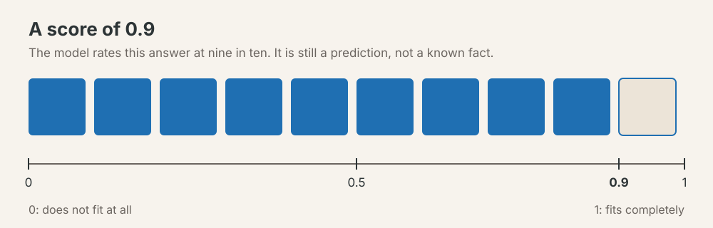{width=100%}

**Feature.** One measurable thing a model or rule looks at. *Example:* the length of a sentence, or how many questions a passage asks. *On SDC's site:* in SDC's first stage a model reads the input and turns it into structured signals, and "extracted features" are among them.

**Neural network.** A kind of model built from many small number-crunching parts joined in layers, loosely inspired by brain cells. Most AI today is made of neural networks.

**Deep learning.** Machine learning with neural networks that have many layers. The "deep" is about the number of layers. It says nothing about deep thought.

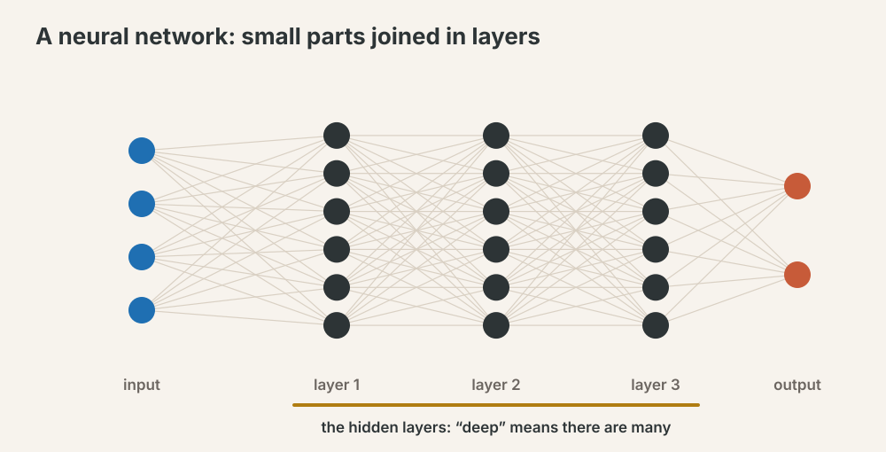{width=100%}

**Generative AI.** AI that makes something new, such as text, pictures or sound, instead of sorting or finding. *In these projects:* ungli is a method for using AI in which no model generates a word, and the method itself says it does not fit generation jobs.

**Chatbot.** A program you talk to by typing, which writes replies. Most chatbots today run on a large language model.

**AI agent.** A program in which a model answers and then goes further, taking steps on its own: searching, running code, calling other programs. *In ungli:* whatever its size, a model that plans the order of steps, or writes a step for another model, is outside the method.

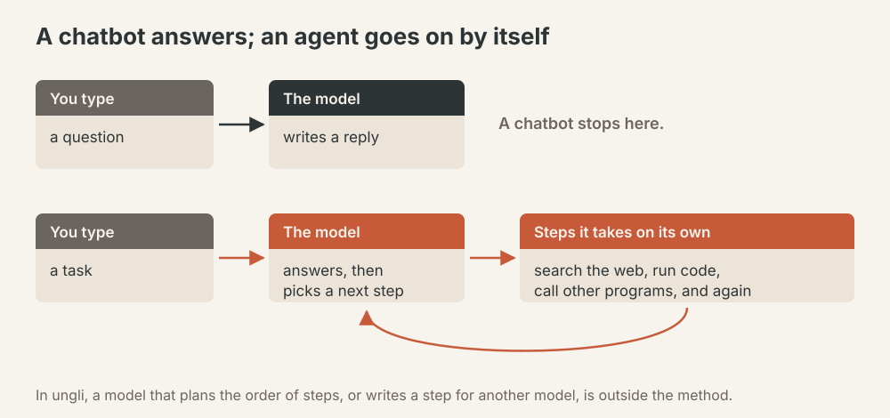{width=100%}

**Parameters (also called weights).** The numbers inside a model that get adjusted during training. Picture a great many tiny dials: millions in a small model, billions in a large one. When people give a model's size, they usually count its parameters. *Example:* the reader inside rai, Koher's model that checks whether a description is complete, has about 33 million; GPT-3, an early large model, had 175 billion (Ouyang and colleagues describe it at that size, 2022). *In these projects:* *Visible to Whom?*, a Koher position, argues that criteria hidden in weights can be reached by the engineer but not by the person a decision affects, and that the criteria have to be written somewhere else, as rules, if that person is to see them. The same position says that for many uses, such as search, this matters much less.

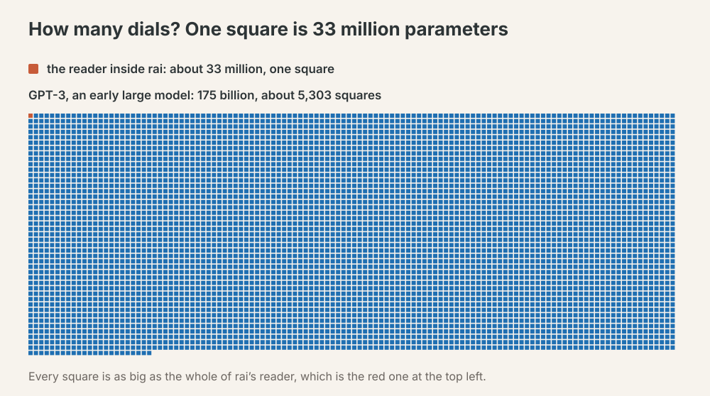{width=100%}

**Base model and checkpoint.** A base model is a trained model that others start from instead of training from nothing. A checkpoint is a copy of a model saved at one moment in its training. *In ungli:* the readers in rai and RAM are both fine-tuned from the same base.

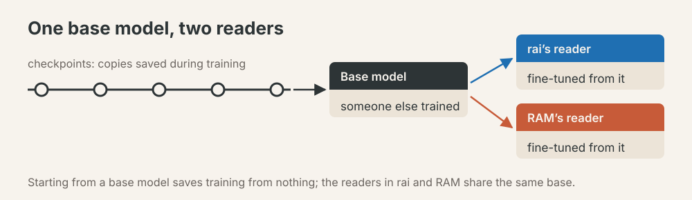{width=100%}

**Open weights and open source.** A model has open weights when anyone can download its parameters and run it. Open source means the code (and sometimes the training data) is published too, with a licence that lets people use and change it. What should count as open source for AI models is still argued about. *In ungli:* every model in its table of models for searching by meaning has an open licence.

**Compute.** The amount of computer work needed to train or run a model, and so the electricity and money it costs. The biggest models need thousands of GPUs (see CPU and GPU) for weeks. A small model needs far less. The reader in RAM, one of the models built on ungli, starts from a base model someone else had already trained, and its own training then takes about 155 seconds a run on one computer built for AI work.

**Training.** Showing a model examples and nudging its dials, again and again, until it gets the examples right more often. *In ungli:* RAM is Koher's model that points at who will do each act in a piece of office writing. Its reader trains in about 155 seconds a run, starting from a base model someone else trained, and ungli gives this as one example of small models costing less to train.

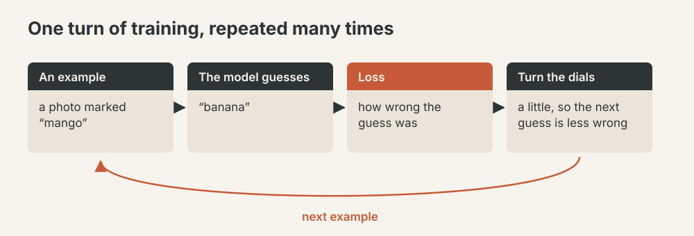{width=100%}

**Training data, dataset, corpus.** The examples a model learns from. A dataset is a prepared collection of them, and a corpus is a large collection of text. *In these projects:* ungli names a problem here. The base model that rai's and RAM's readers start from was trained partly on books taken without asking their authors.

**Label.** The correct answer attached to a training example, usually written by a person. *Example:* a photo with the word "mango" attached. *In ungli:* people who know a field write the labels for a domain guide, and ungli says "the labels carry the judgement".

**Pretraining and fine-tuning.** Pretraining is the long first training on a huge amount of general text. Fine-tuning is a shorter second training that teaches the model one particular job. *Example:* learning to read in school is pretraining; learning to read a railway timetable afterwards is fine-tuning. BERT is a well-known model trained in these two steps: Devlin and colleagues (2019) pretrained it on a huge amount of text, then fine-tuned a copy for each new job.

**Inference.** Using a trained model to get an answer. Training happens before a model is used; inference happens every time someone uses it. *In ungli:* the method gives six reasons for using small models, and one of them is the cost of inference, since a small model can run on an ordinary computer.

## 2. How a model is trained

**Supervised learning.** Training on examples that come with the right answer attached (labels). From each example, the model learns to give the answer. *Example:* thousands of emails marked "spam" or "not spam".

**Unsupervised and self-supervised learning.** Training without answers attached to the examples. In self-supervised learning the data supplies its own answers. Hide a word, and the model guesses it from the words around it. BERT was pretrained this way (Devlin and colleagues, 2019).

**Reinforcement learning.** Training by reward: the model tries something, gets a score for how well it went, and is nudged towards whatever scored well. Human feedback (section 5) is one kind.

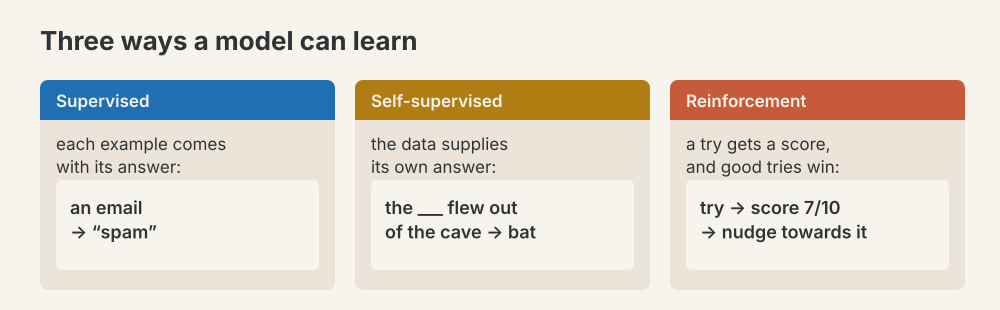{width=100%}

**Loss.** A number that measures how wrong a model's answers are on its training examples. Training tries to bring it down.

**Gradient descent.** The usual way training lowers the loss. For each dial, it works out which way to turn so the answers get a little less wrong. Then it turns the dial, a little. *Example:* walking down a hill in fog by always stepping where the ground slopes down.

**Learning rate.** How big each of those little turns is. Too big, and training jumps about. Too small, and it barely moves.

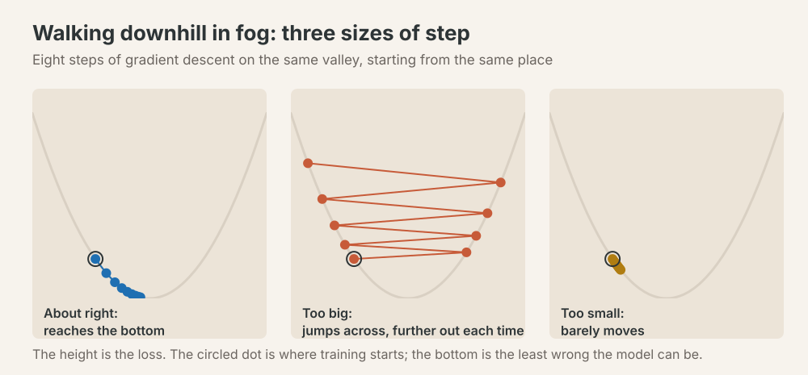{width=100%}

**Epoch and batch.** An epoch is one full pass through all the training examples. A batch is the small group of examples the model looks at before each nudge.

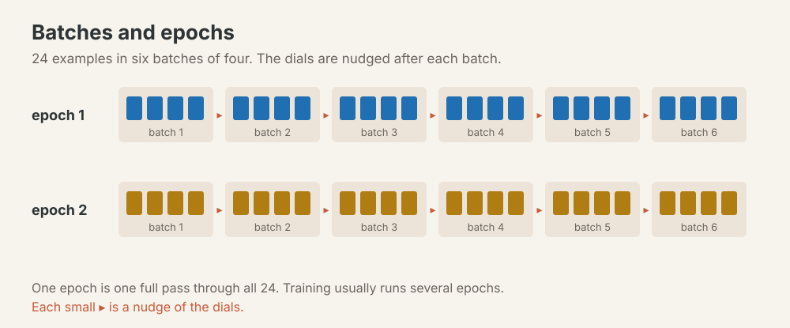{width=100%}

**Training, validation and test sets.** The examples are split into three piles. The model learns from the training set. People use the validation set to make choices while they build it. The test set is kept back until the end, and only then shows how well the model works. *In ungli:* these kept-back examples are called held-out cases (section 6).

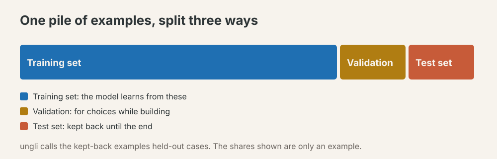{width=100%}

**Overfitting and generalisation.** A model overfits when it learns its training examples so closely, odd details and all, that it does badly on new ones. It is like a student who memorises last year's answers without understanding the subject. Generalisation is doing well on examples it has never seen. That is what training is for.

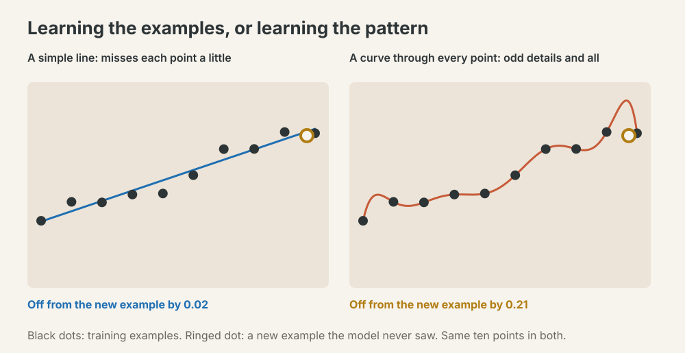{width=100%}

**Hyperparameter.** A setting people choose before training starts, such as the learning rate or the number of epochs. The model learns its parameters; people pick its hyperparameters.

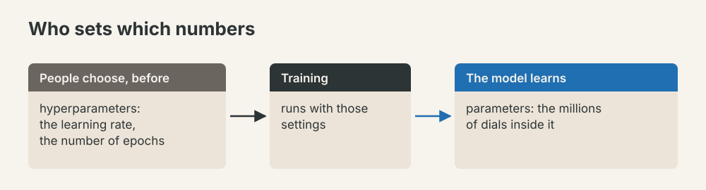{width=100%}

**Random seed.** A starting number for the randomness used in training. Train twice with the same seed and you usually get the same model, though some computers add randomness of their own. Change the seed and the model comes out slightly different. A result that holds over several seeds is less likely to be luck.

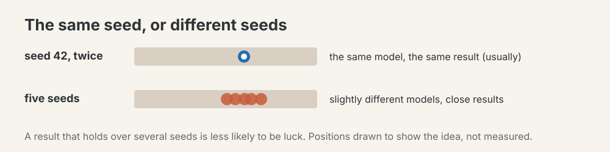{width=100%}

**Synthetic data.** Training examples made by a program, or by another model, rather than collected from the world. *In ungli:* RAM's reader learnt from 14,000 generated rows of office writing, which a large model helped to write.

**Ground truth.** The answers people have checked and agree are correct. A model is measured against them.

**Quantisation.** Making a model smaller and faster by storing its numbers with less precision, like rounding 3.14159 to 3.14. It saves memory but can cost accuracy, so how much accuracy is lost has to be measured.

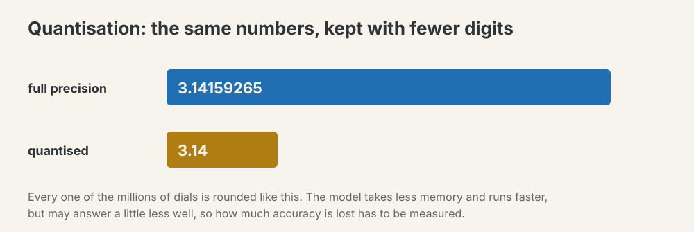{width=100%}

## 3. How a language model reads

**Token.** A piece of text a model reads as one unit. It can be a whole word, part of a word or a punctuation mark, and a long word may be split into several tokens. *In these projects:* ungli, and SDC's way of assembling work called JCAS, hold a model's answer to "a few tokens", and those tokens can only be numbers.

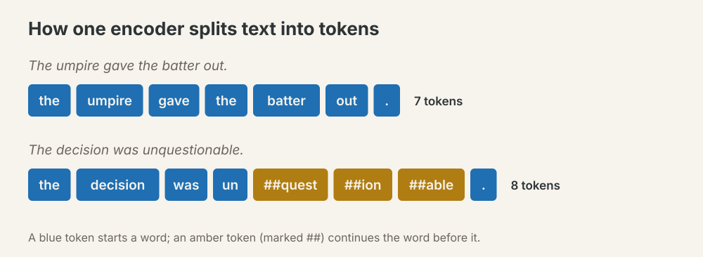{width=100%}

**Language model.** A model trained on text, so that it can work with language: sort it, find things in it, or write it. *In these projects:* SDC holds that a language model is good at spotting patterns in language but cannot be relied on for verdicts that have to be repeatable and checkable. Some researchers report that models can judge consistently under fixed settings.

**Large language model (LLM).** A very big language model, with billions of parameters, that writes text one token after another. The chat programs most people know are built on these.

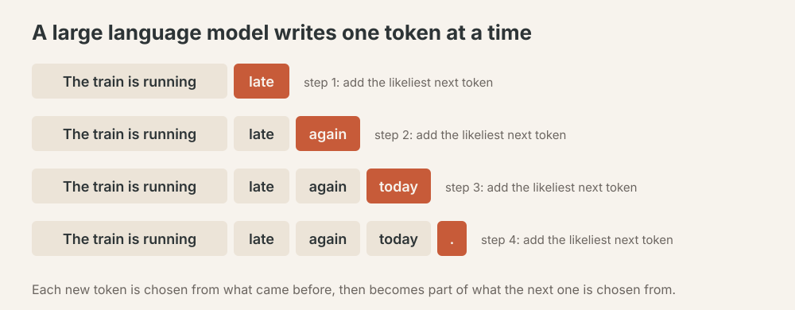{width=100%}

**Transformer.** The design inside almost every modern language model. It looks at the words of a passage together and works out how each word relates to the others. In most models that write, each word looks only at the words before it. It was introduced by Vaswani and colleagues in 2017.

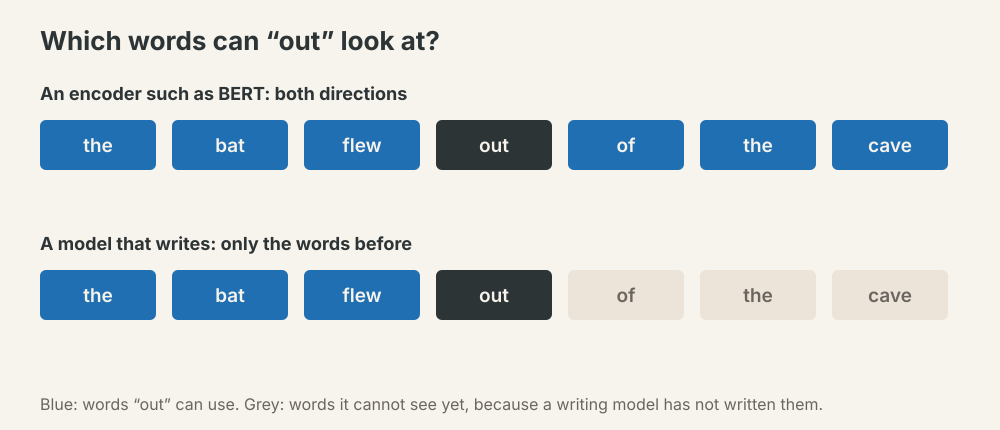{width=100%}

**Attention.** The part of a transformer that decides which other words matter for understanding a word. *Example:* take "the bat flew out of the cave". In a model that reads in both directions, such as BERT, the word "cave" tells the model that this bat is an animal and not a cricket bat. (Koher's position *The User Has Somewhere Else to Be* means something else by "attention": the ordinary human kind.)

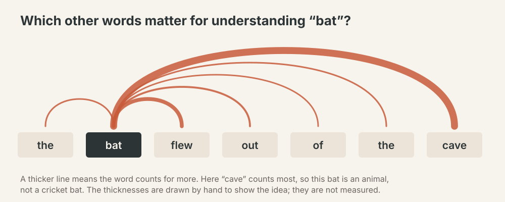{width=100%}

**Encoder.** A model that reads text and turns it into numbers, without writing anything. *In ungli:* none of the models it runs writes. Each answers with a number or with nothing.

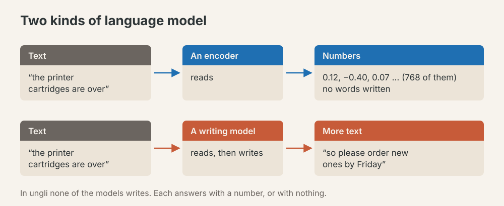{width=100%}

**BERT, DeBERTa and MiniLM.** Three encoders, each built on the transformer. BERT reads a sentence in both directions at once (Devlin and colleagues, 2019). DeBERTa improves on it by keeping track of a word's meaning and its position separately (He and colleagues, 2021). One of Koher's older tools, the Coherence Diagnostic, uses DeBERTa to score writing. MiniLM is a small student model trained to copy how a larger teacher model pays attention (Wang and colleagues, 2020). The readers in rai and RAM start from a version of MiniLM already trained to answer questions.

**Distillation.** Training a small model to copy the behaviour of a big one, as a student learns from a teacher. MiniLM's authors report that one of their students, half the size of its teacher, kept over 99% of the teacher's accuracy on some tests (Wang and colleagues, 2020).

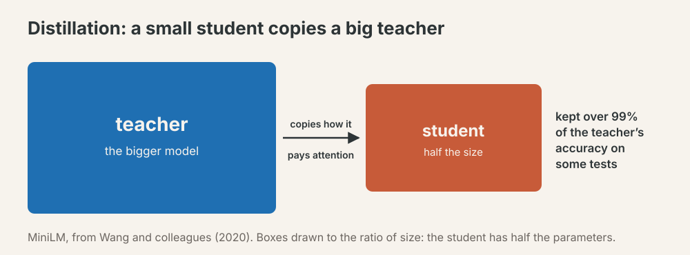{width=100%}

**Small model.** A model with few enough parameters to run cheaply on an ordinary computer. *In these projects:* the word means more than that. In ungli, small means the model's size, and also that it runs with no paid server and no fee for each answer, even in a web browser. ungli and SDC's JCAS also use another sense, *the size of the window, not the door*: a model of any size counts as small when code holds what comes out of it to a few tokens, all of them numbers.

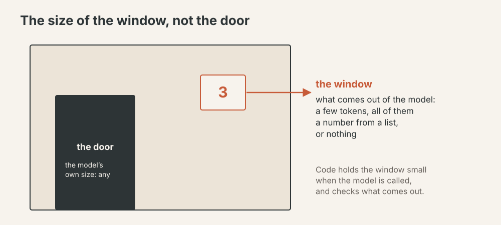{width=100%}

**Prompt.** The text you type to a language model to tell it what to do. *In these projects:* Koher's position *The Envelope of the Prompt* argues that no prompt can make a judgement consistent or checkable, and that only something outside the prompt, such as rules in code, can. Others hold that careful prompts with a written rubric come close.

**Context window.** How much text a model can read at once. Anything beyond it, the model does not see at all. *In ungli:* the pointer reads about the first 380 tokens of a text and finds nothing past them. So a long text goes to the finder first.

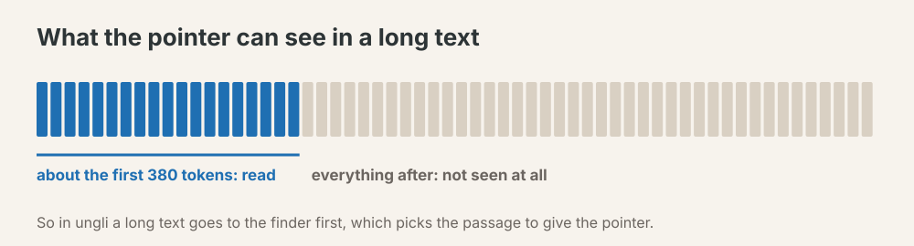{width=100%}

**Temperature.** A setting that controls how much randomness a model uses when it writes. At temperature 0 the same question gets the same answer much more often. *In these projects:* two of Koher's older tools, Sensorium and the Coherence Diagnostic, run their narrator at temperature 0.

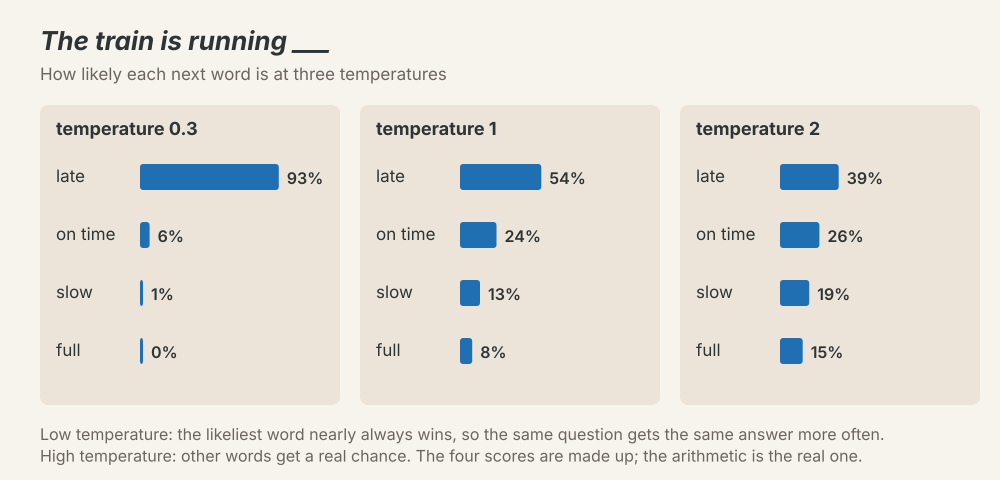{width=100%}

**Multimodal and vision models.** A multimodal model works with more than one kind of input, such as text and pictures together. A vision model works with images. *In ungli:* the chooser has been tried once, with a model that sorts sounds. That model takes only one kind of input, so it is neither multimodal nor a vision model.

**Hosted model and API.** A hosted model runs on somebody else's computers. You send it text over the internet through an API (a doorway one program uses to talk to another), and you usually pay for each answer. *In these projects:* OpenRouter is a service that connects to many hosted models, and Koher's older tools reach their narrator through it. ungli prefers models that run on your own machine, where no answer carries a fee.

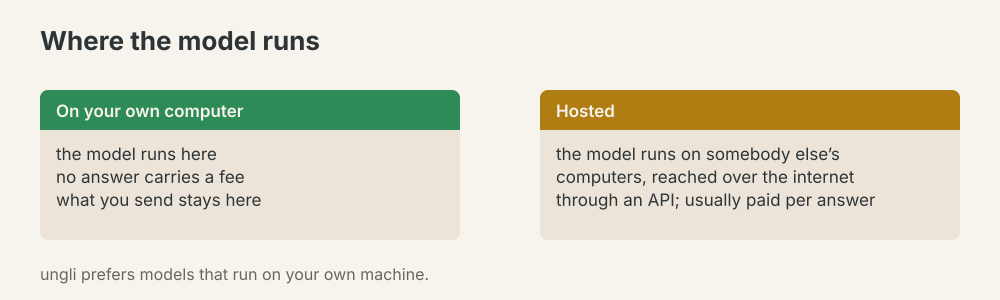{width=100%}

**CPU and GPU.** The CPU is the main chip in any computer. A GPU is a chip built to do huge numbers of small sums at once, which is what training needs. *In ungli:* an ordinary CPU is enough to run the readers in rai and RAM.

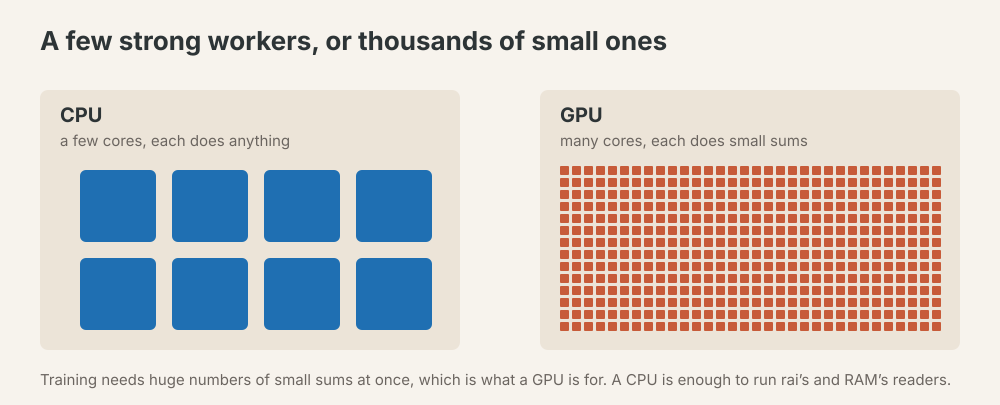{width=100%}

## 4. Finding things by meaning

**Vector.** A list of numbers in a fixed order. Each number is one dimension. A point on a map has two of them: how far east, and how far north. An embedding can have hundreds.

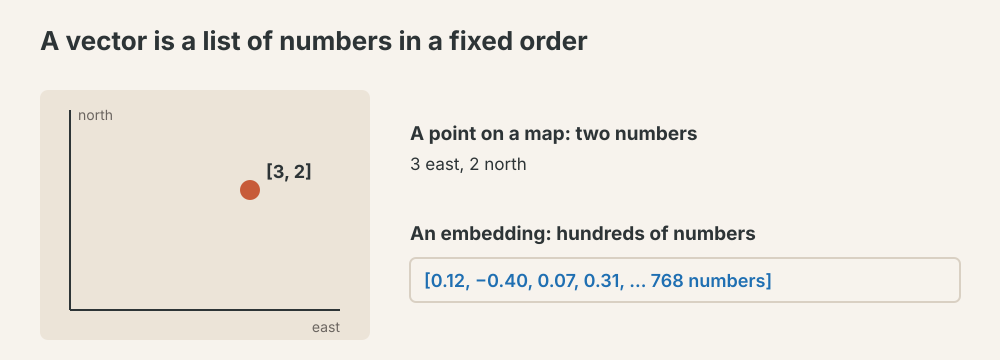{width=100%}

**Embedding.** A list of numbers that stands for a piece of text, made so that texts close in meaning get close numbers. *Example:* in a library, books on similar subjects sit on nearby shelves. An embedding gives every passage a shelf position. *In SDC:* an embedding is one of the "signals" that come out of the first stage.

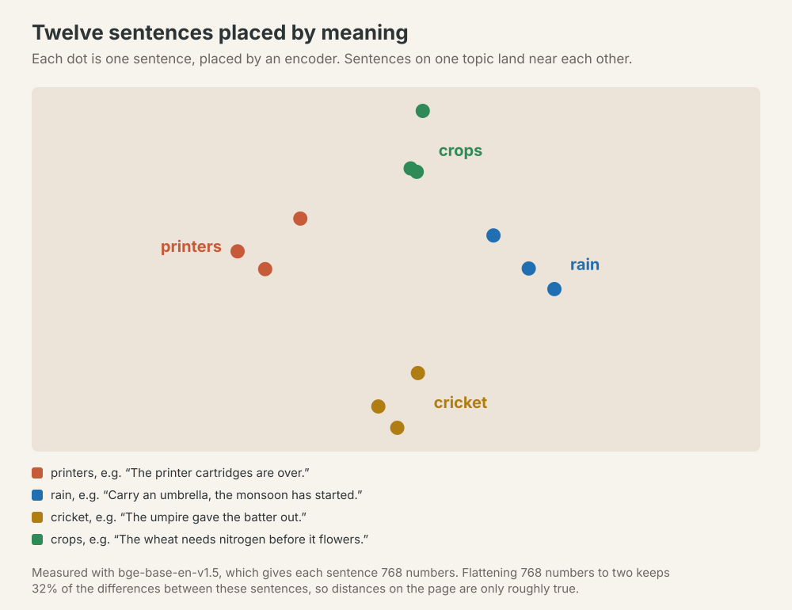{width=100%}

**Similarity.** How close two embeddings are, worked out with arithmetic. Close numbers mean the texts are about the same thing, which is not always the same as being the right answer (see Domain guide).

**Semantic search.** Searching by meaning instead of by matching words. *Example from ungli:* asking about *ink for the printer* finds the sentence *the printer cartridges are over*, though the sentence never says *ink*. Sentence-BERT made it much faster than having BERT read every pair: finding the closest pair among 10,000 sentences went from about 65 hours to about 5 seconds (Reimers and Gurevych, 2019).

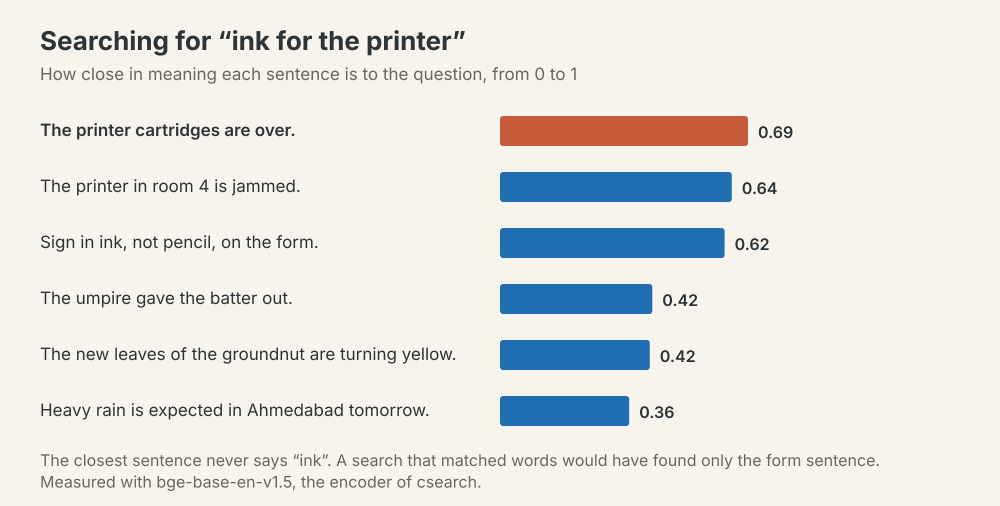{width=100%}

**Finder.** *ungli's word* for the semantic-search layer. Ask it a question and it answers with the number of the passage closest in meaning, or with nothing.

**Late interaction (ColBERT).** A way of searching that keeps a set of numbers for each word of a passage, so it can match finer details. Khattab and Zaharia (2020) built it to do this far faster than earlier search with BERT. *In ungli:* an optional second step after the finder, used only where a measurement shows it helps.

**Cross-encoder (re-ranker).** A model that reads a question and one passage together and gives a score for how well they fit. Because it reads each question and passage as a pair, nothing can be worked out in advance. That makes it slower than an encoder that reads each passage once. *In ungli:* it is used only on the few passages the finder has already found, where a measurement shows it helps.

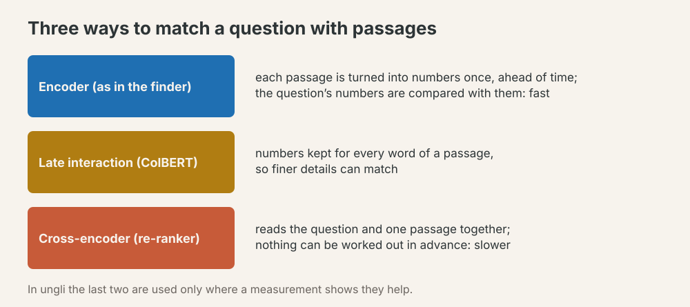{width=100%}

**Retrieval-augmented generation (RAG).** Before a writing model answers, a search finds some passages and hands them over, so the model has material that may be relevant in front of it. *On Koher's site:* *The Envelope of the Prompt* names it as one way to change what a model sees. ungli keeps the search and leaves out the writing.

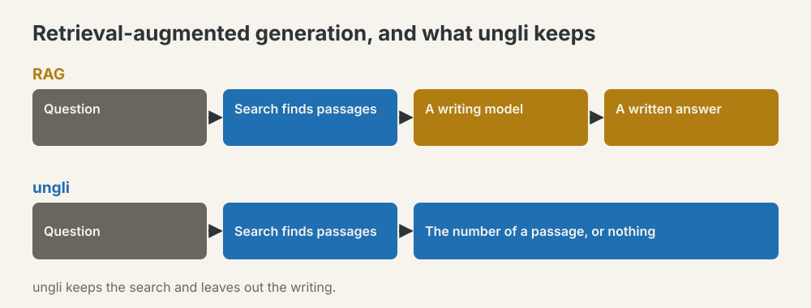{width=100%}

**Classifier and classification.** A classifier is a model that sorts things into groups chosen in advance. *Example:* an email program sorting mail into "spam" and "not spam". *In Koher's Coherence Diagnostic:* a DeBERTa classifier says how strongly a piece of writing shows each of five things, and the rules sort each answer into strong, thin or unclear.

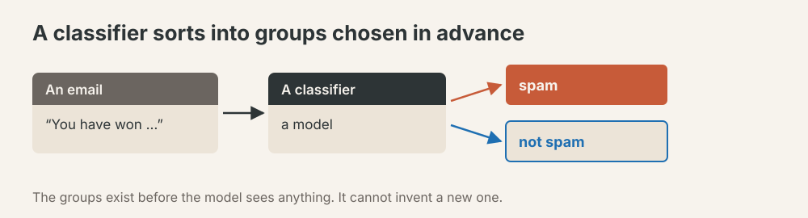{width=100%}

**Zero-shot and few-shot.** Asking a model to do a job with no worked examples (zero-shot) or with only a handful (few-shot), instead of training it on many. *On Koher's site:* listed as one way to work when no training data exists yet.

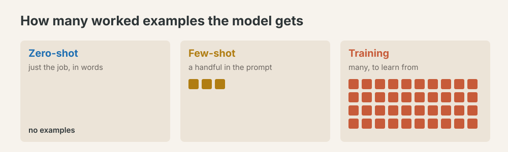{width=100%}

## 5. How models go wrong, and how anyone can tell

**Hallucination.** When a language model states something false as if it were true. Kalai and colleagues (2025) argue that some mistakes start in training itself, and that testing keeps them going: models are tested the way students are in an exam with no minus marks. A guess sometimes scores, and "I don't know" never does, so the model learns to guess. *Example:* the same paper names India's JEE among the exams that take marks off for a wrong answer. In JEE Main a wrong answer costs a mark, so guessing is no longer free; in a test with no minus marks, a guess can only gain. *In these projects:* Koher's position *The Mathematical Proof of Hallucination* says some uses can accept hallucination, and draws its own lesson for Koher's tools: keep the model away from judging, and let it read, or narrate a decision made elsewhere. In Koher's newer work no model writes at all.

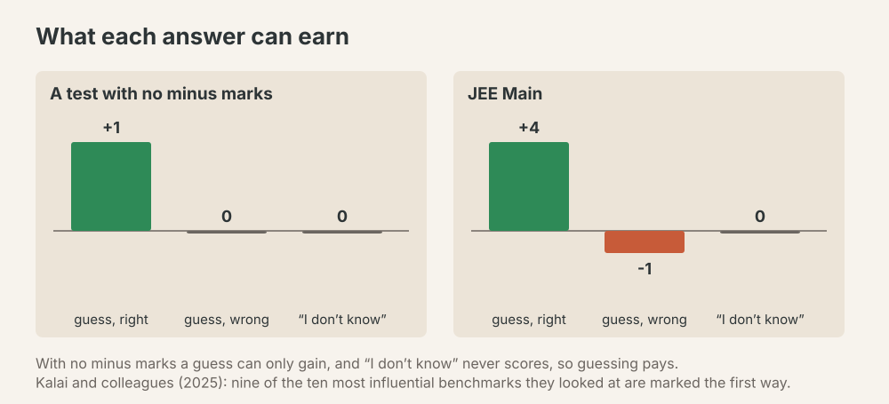{width=100%}

**Sycophancy.** When a model tells you what you seem to want to hear instead of what is true. Sharma and colleagues (2024) found it in all five AI assistants they tested, and found signs that part of it comes from training on people's ratings: people tended to prefer answers that agreed with their own views. *Example:* a friend who praises your drawing because they can see you want them to. *In these projects:* SDC argues that failures follow when one channel does both language and judgement, and counts "sycophancy in machines" among them.

**Human feedback (RLHF).** A way of training a model in which people rate its answers, and the model is nudged towards the answers people preferred (Ouyang and colleagues, 2022). Ouyang and colleagues found that people preferred the answers of models trained this way. Models trained this way can also get sycophantic (Sharma and colleagues, 2024). *On SDC's site:* SDC's variant on data work in India describes some of the people paid to do this kind of rating.

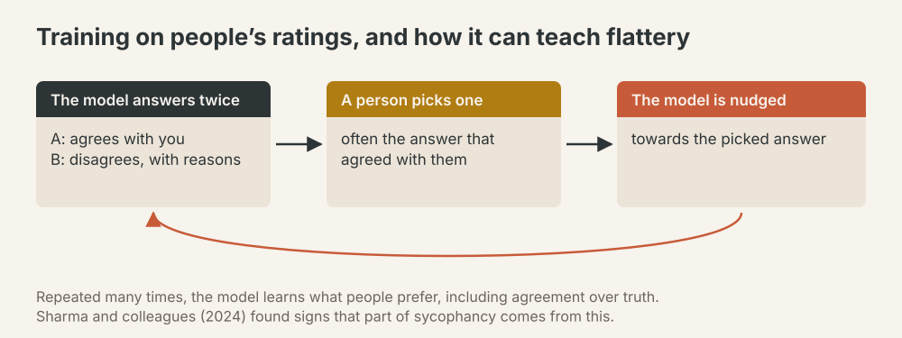{width=100%}

**Bias.** When a model's answers lean unfairly in one direction because of what was, or was not, in its training data, or because of how it was built or used.

**Black box.** A model whose reasons cannot be seen or read by the people its answers affect, and often not fully even by the people who made it. Rudin (2019) argues that when a decision matters, people should use models whose workings can be read, instead of explaining black boxes afterwards. *In these projects:* Koher and SDC keep the judgement out of the model. It sits in rules that anyone can read, and people decide.

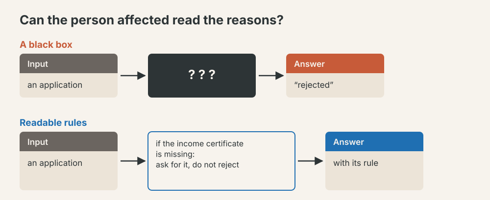{width=100%}

**Drift.** In machine learning, the world changing while a model stays the same, so the model's answers slowly get worse. *In SDC:* "drift under pressure" means a judge's standard shifting towards whoever is loudest.

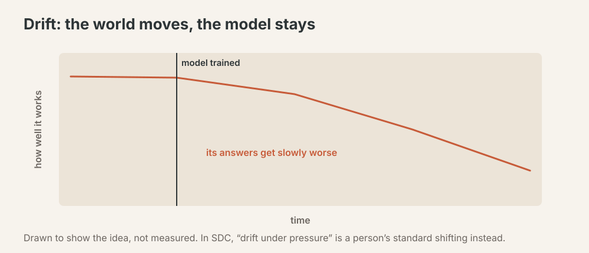{width=100%}

**Benchmark and evaluation.** A benchmark is a fixed test that many models take, so their scores can be compared. Evaluation is any testing of how well a model works. *In these projects:* Koher's hallucination position reports a finding of Kalai and colleagues (2025): nine of the ten most influential benchmarks they looked at give no credit for "I don't know", so they reward guessing.

**Accuracy.** The share of answers a model gets right. One accuracy number can hide which mistakes were made. ungli reports what was missed and what was wrongly let through separately, and says which of the two mistakes it would rather make.

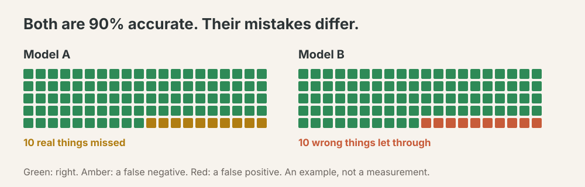{width=100%}

**False positive and false negative.** A false positive is a wrong "yes": the model says something is there when it is not. A false negative is a wrong "no": it misses something that is there. *Example:* a plagiarism checker that flags an essay the student wrote herself gives a false positive; one that misses a copied essay gives a false negative. *In ungli:* the method would rather miss a real answer (a false negative) than accept a non-answer (a false positive).

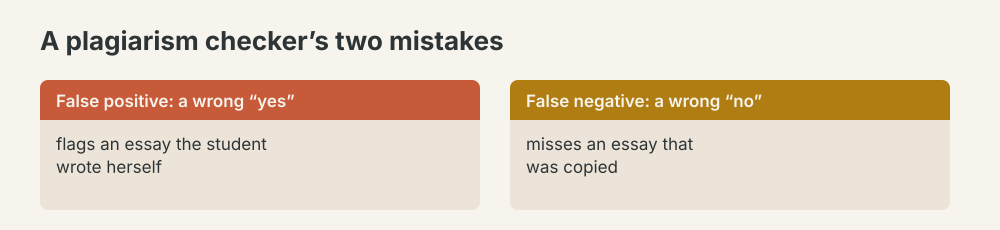{width=100%}

**Precision and recall.** Precision is the share of the things a model said "yes" to that were right. Recall is the share of the right things that it found. A model can have one high and the other low. *In ungli:* rai found 64 of 96 real answers, a recall of two in three, and counted none of 72 non-answers as answers, so it had no false positives.

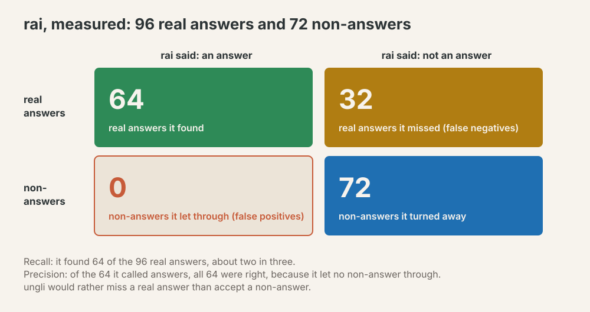{width=100%}

**Baseline.** A simple method used for comparison, to show whether a model adds anything. *In ungli:* on five test sets written by models, with the right answers marked by hand, a plain parser on its own got 162 of 178 acts right. That parser is the baseline. RAM got all 178 right, naming the right doer, or nobody where the note named nobody. Notes written by office staff have not been measured yet.

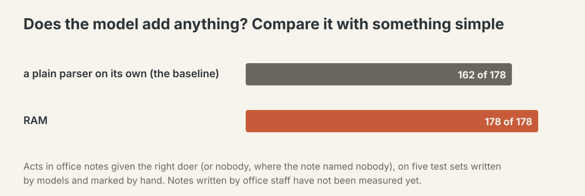{width=100%}

**Reproducibility.** Whether someone else, or you next week, can run the same thing and get the same result. Rules in deterministic code give the same result every time. A chat model's answer often does not.

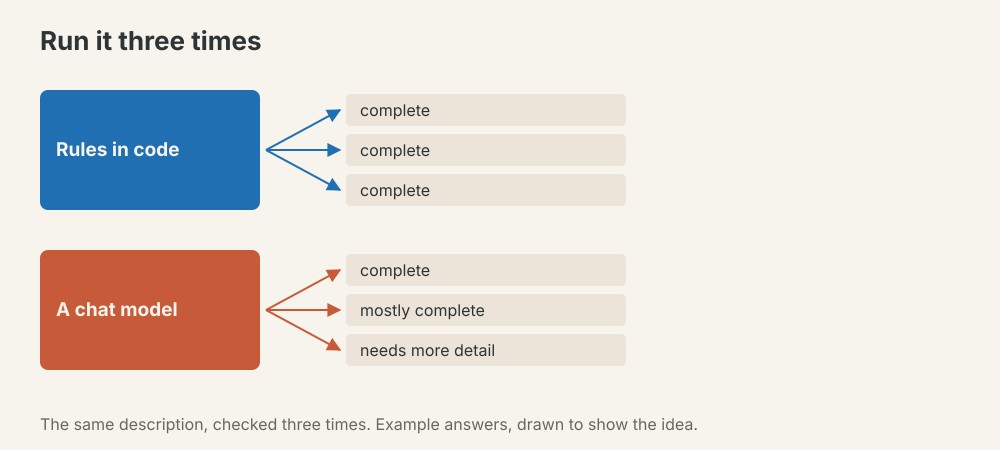{width=100%}

**Confidence and calibration.** Confidence is how sure a model reports itself to be. A model is well calibrated when it is right about as often as it says it is. Take the answers it gives 70% to: about seven in ten of them are right. *On SDC's site:* "calibrate" is said of people too. SDC argues that a person cannot calibrate when the reasons for a verdict were never kept apart from the verdict itself.

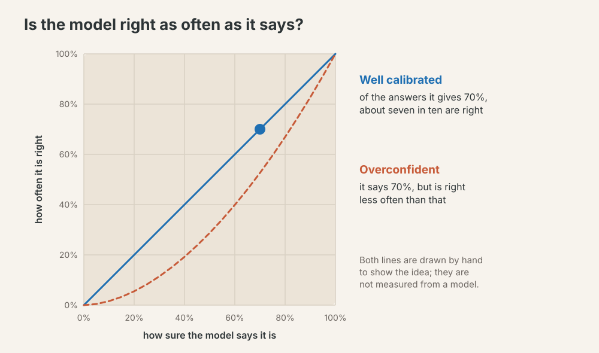{width=100%}

## 6. Words these projects use in their own way

**Language work and judgement work.** *SDC's central words.* Language work describes, reads and writes. Judgement work decides: good or bad, pass or fail, first or last. SDC claims these are unlike kinds of thinking, and that trouble follows when one channel is asked to do both. It also names work where it does not apply, such as a speech meant to move people. *Example:* in cricket, the umpire does judgement work, giving the batter out, and the commentator does language work, describing the ball. Commentators often judge as well ("a poor shot"), which is the kind of mixing SDC writes about.

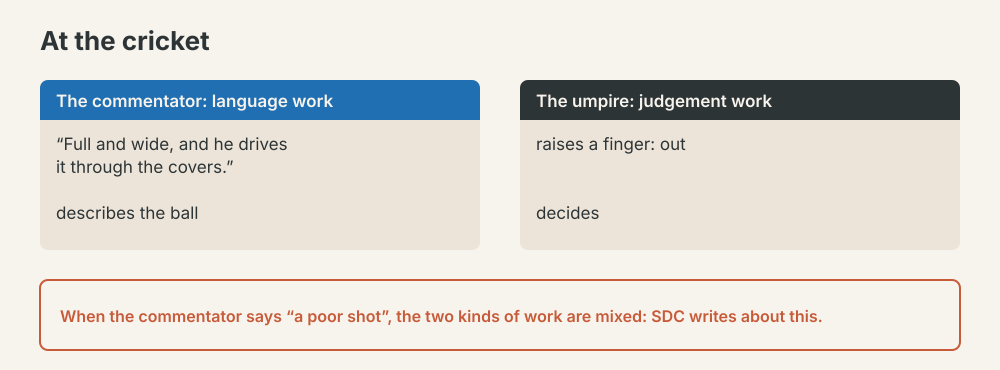{width=100%}

**The collapse.** *SDC's word* for language work and judgement work fused in one channel. Asking a chat model whether an essay is good is one. SDC argues that nobody can then see the criteria behind the verdict, so nobody can check it.

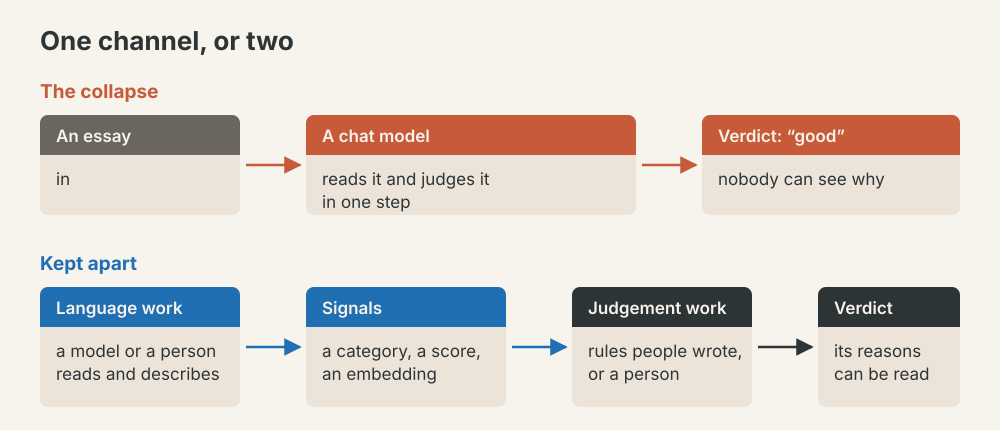{width=100%}

**Split-Domain Cognition (SDC).** The principle that keeps language work and judgement work apart, in people, institutions and machines, so that both serve the intent of the person doing the work.

**Signal.** *SDC's and Koher's word* for what the first layer hands over to the rules: a structured piece of information, such as a category, a score or an embedding. A model or a person can produce it.

**Qualification.** *Koher's name* for the first layer in its older tools. Here a model or a person reads the input and picks out what is present, as signals.

**Rules (deterministic code).** Code written by people that turns signals into a decision. "Deterministic" means the same input always gives the same output. *In these projects:* the final judgement lives here, in a form people can read.

**Verdict.** The final call: a ranking, a pass or fail, *complete* or *not complete*. *In these projects:* a verdict comes from rules that people wrote, or from a person. A model never makes one; a model's score is a signal, which the rules turn into a verdict.

**Threshold.** A cut-off number in the rules: above it one thing happens, below it another. *In ungli:* each layer's threshold is set on examples that people answered by hand. It is then checked on examples the model never saw.

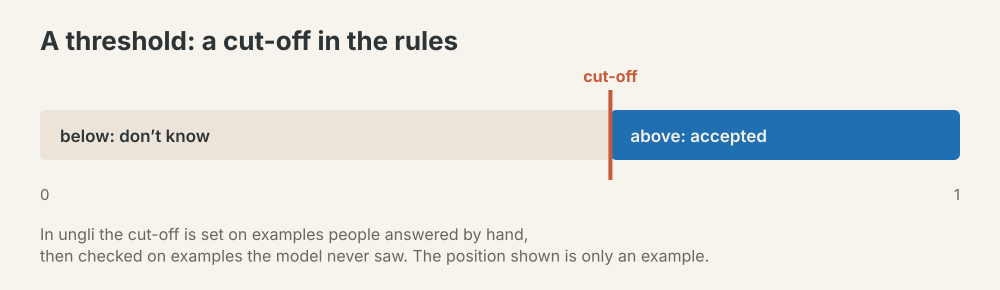{width=100%}

**Language layer (narration).** *Koher's name* for the last layer in its older tools. The rules have already made the decision, and here a model narrates it in readable sentences. Koher's position *Is the User the Person?* describes a list of forbidden strings that checks what the narrator writes. *In new work:* no model writes at all.

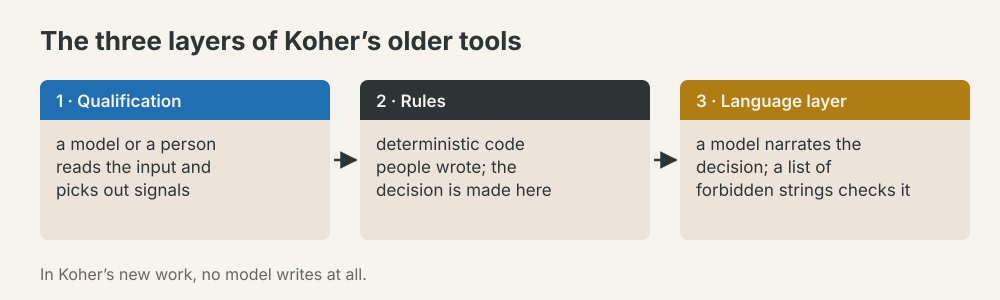{width=100%}

**Layer.** One step in a chain of steps, each doing one job. (A neural network has layers too, inside the model; this is the other sense.) *In ungli:* small models in layers, each taking one small step that code can check.

**Pointer and reader.** A small model that answers a question by pointing at the place in the text that holds the answer, or at nothing. *ungli's* scaffold has a pointer that answers with the number of a sentence. A reader is trained further and points at the exact words; rai and RAM each have one. Since a pointer or a reader can only point at words already in front of it, it cannot write a word of its own, though it can point at the wrong words.

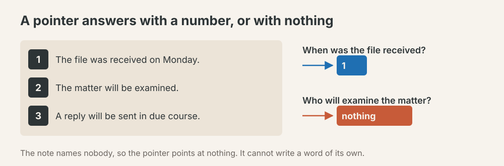{width=100%}

**Chooser.** *ungli's word* for a small model that picks one item from a list written in advance, or picks nothing.

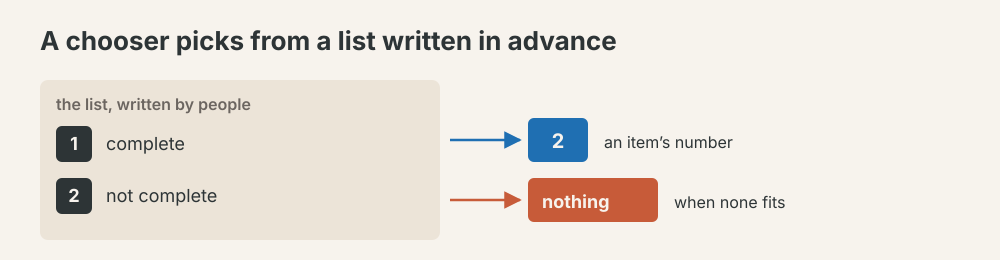{width=100%}

**Domain guide.** *ungli's word* for a small model trained for one field, on questions and passages labelled by people who know that field. *Example from ungli:* an encoder puts nitrogen shortage and iron shortage close together, because both turn leaves yellow. A person who knows groundnut, which often grows on chalky soil, sees yellowing between the veins of new leaves and thinks first of iron. No domain guide has been trained yet.

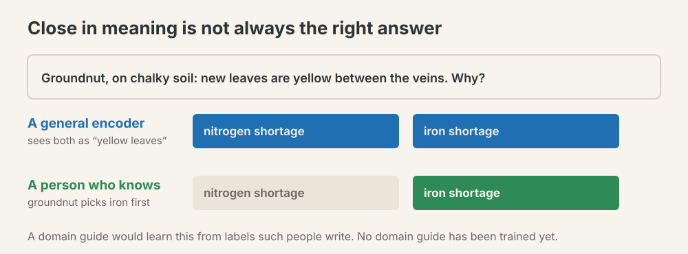{width=100%}

**The window.** *ungli's and SDC's word* for what may pass out of a model: a few tokens, limited when the model is called and checked by code, and only ever a number from a list, or nothing. That is what "the size of the window, not the door" means: the window is what comes out of a model, the door is the model's own size, and only the window has to be small.

**Don't know.** In ungli, a model may answer with a number from its list, or with nothing. Code treats any other output, or an answer scored too low to trust, as *don't know*, and the case then goes to a person, or to rules people wrote in advance.

**Router.** *ungli's word* for a table written by people that sends each kind of case through its layers in order. No model chooses the order.

**Top call.** *ungli's word* for the final decision. It is taken from a list written in advance, such as *complete* or *not complete*.

{width=100%}

**Held-out cases.** Examples kept back from training and from setting thresholds, so the model is tested on cases it has never seen (the test set of section 2). A test on cases it trained on would say little about how it does on new ones.

**Scaffold.** *ungli's word* for the few small code files anyone can copy, under their open licence, to build a system in layers.

## Papers named in this glossary

Where a free copy exists, the note after the reference says so.

Devlin, J., Chang, M.-W., Lee, K., & Toutanova, K. (2019). BERT: Pre-training of deep bidirectional transformers for language understanding. In *Proceedings of the 2019 Conference of the North American Chapter of the Association for Computational Linguistics: Human Language Technologies, Volume 1 (Long and Short Papers)* (pp. 4171–4186). Association for Computational Linguistics. https://doi.org/10.18653/v1/N19-1423 (free to read)

He, P., Liu, X., Gao, J., & Chen, W. (2021). DeBERTa: Decoding-enhanced BERT with disentangled attention. *International Conference on Learning Representations (ICLR 2021)*. https://openreview.net/forum?id=XPZIaotutsD (preprint free at https://arxiv.org/abs/2006.03654)

Kalai, A. T., Nachum, O., Vempala, S. S., & Zhang, E. (2025). *Why language models hallucinate* (arXiv:2509.04664). arXiv. https://arxiv.org/abs/2509.04664 (free to read; a related paper by the same four authors appeared in *Nature* in 2026, https://doi.org/10.1038/s41586-026-10549-w)

Khattab, O., & Zaharia, M. (2020). ColBERT: Efficient and effective passage search via contextualized late interaction over BERT. In *Proceedings of the 43rd International ACM SIGIR Conference on Research and Development in Information Retrieval* (pp. 39–48). Association for Computing Machinery. https://doi.org/10.1145/3397271.3401075 (free copy at https://arxiv.org/abs/2004.12832)

Ouyang, L., Wu, J., Jiang, X., Almeida, D., Wainwright, C., Mishkin, P., Zhang, C., Agarwal, S., Slama, K., Ray, A., Schulman, J., Hilton, J., Kelton, F., Miller, L., Simens, M., Askell, A., Welinder, P., Christiano, P., Leike, J., & Lowe, R. (2022). Training language models to follow instructions with human feedback. In S. Koyejo, S. Mohamed, A. Agarwal, D. Belgrave, K. Cho, & A. Oh (Eds.), *Advances in Neural Information Processing Systems 35* (pp. 27730–27744). Curran Associates. https://doi.org/10.52202/068431-2011 (free to read on the NeurIPS proceedings site)

Reimers, N., & Gurevych, I. (2019). Sentence-BERT: Sentence embeddings using Siamese BERT-networks. In *Proceedings of the 2019 Conference on Empirical Methods in Natural Language Processing and the 9th International Joint Conference on Natural Language Processing (EMNLP-IJCNLP)* (pp. 3980–3990). Association for Computational Linguistics. https://doi.org/10.18653/v1/D19-1410 (free to read)

Rudin, C. (2019). Stop explaining black box machine learning models for high stakes decisions and use interpretable models instead. *Nature Machine Intelligence, 1*(5), 206–215. https://doi.org/10.1038/s42256-019-0048-x (preprint free at https://arxiv.org/abs/1811.10154)

Sharma, M., Tong, M., Korbak, T., Duvenaud, D., Askell, A., Bowman, S. R., Cheng, N., Durmus, E., Hatfield-Dodds, Z., Johnston, S. R., Kravec, S., Maxwell, T., McCandlish, S., Ndousse, K., Rausch, O., Schiefer, N., Yan, D., Zhang, M., & Perez, E. (2024). Towards understanding sycophancy in language models. In *International Conference on Learning Representations (ICLR 2024)* (pp. 110–144). https://proceedings.iclr.cc/paper_files/paper/2024/hash/0105f7972202c1d4fb817da9f21a9663-Abstract-Conference.html (free to read; preprint at https://arxiv.org/abs/2310.13548)

Vaswani, A., Shazeer, N., Parmar, N., Uszkoreit, J., Jones, L., Gomez, A. N., Kaiser, Ł., & Polosukhin, I. (2017). Attention is all you need. In *Advances in Neural Information Processing Systems 30* (pp. 5998–6008). Curran Associates. https://proceedings.neurips.cc/paper_files/paper/2017/hash/3f5ee243547dee91fbd053c1c4a845aa-Abstract.html (free to read)

Wang, W., Wei, F., Dong, L., Bao, H., Yang, N., & Zhou, M. (2020). MiniLM: Deep self-attention distillation for task-agnostic compression of pre-trained transformers. In *Advances in Neural Information Processing Systems 33* (pp. 5776–5788). Curran Associates. https://proceedings.neurips.cc/paper_files/paper/2020/hash/3f5ee243547dee91fbd053c1c4a845aa-Abstract.html (free to read)
